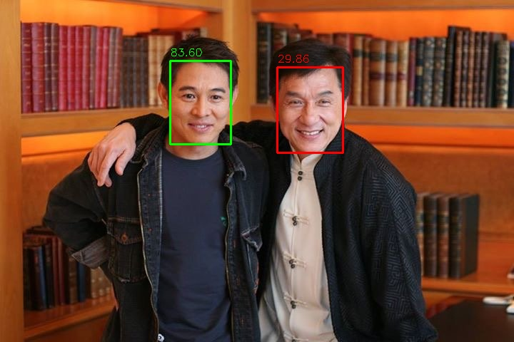

  

<h1 align="center">Face AI</h1>

  <strong>Offline Face Recognition. Intelligent Security. Cross-Platform Privacy.</strong>

  An open-source application for face detection, facial recognition, and privacy-focused access control, powered by on-device AI.

  
  
  
  
  

---

Overview

Face AI is an open-source, cross-platform application that brings face detection and facial recognition directly to your device.

Built with Python, Kivy, and KivyMD, the application combines computer vision and ONNX-based machine learning models to process facial data locally.

The goal is simple: deliver practical facial recognition capabilities without making a cloud service or continuous internet connection a requirement for core recognition features.

From recognizing registered users to protecting sensitive files, Face AI provides a foundation for privacy-conscious, AI-powered security applications.

Why Face AI?

- Offline AI: Run supported face detection and recognition models locally.
- Privacy-focused processing: Keep facial processing on the device during offline operation.
- Facial recognition: Compare facial representations to identify potential matches against registered users.
- Secure file access: Support facial verification workflows for protected files.
- Cross-platform development: Build on a shared Python codebase for supported desktop and mobile platforms.
- Open-source development: Inspect, customize, and extend the application.
- Hardware-assisted inference: Use supported ONNX Runtime execution providers when available.

«Important: Facial recognition is a verification signal, not an infallible security mechanism. Production deployments should include liveness detection where appropriate, secure credential recovery, rate limiting, and additional authentication for high-risk operations.»

---

Core Features

1. Face Detection

Detect faces in supported image and camera inputs using ONNX-based computer vision models.

Capabilities include:

- Face localization in images.
- Camera-based face detection.
- Bounding-box visualization.
- Face-region extraction for subsequent recognition.
- Local inference without requiring a cloud API.

2. Facial Recognition

Generate facial embeddings and compare them against enrolled identities.

The recognition pipeline can support:

- Face enrollment.
- Facial embedding generation.
- Similarity-based matching.
- Registered identity management.
- Configurable recognition thresholds.
- Local identity lookup.

Recognition accuracy depends on model quality, enrollment images, lighting, camera conditions, pose, and threshold configuration.

3. Secure File Vault

Protect sensitive files behind a facial verification workflow.

Depending on the platform and implementation, the vault can support:

- Enrollment-based access authorization.
- Protected-file storage.
- Encrypted file handling on desktop platforms.
- Authentication state management.
- Access-denial handling.
- Secure recovery mechanisms.

Security requirement: Facial recognition must not be treated as encryption. Files should remain encrypted at rest using established cryptographic libraries and properly managed encryption keys. Successful recognition should authorize a controlled key-release or decryption operation.

4. Offline-First Architecture

The core recognition pipeline is designed to operate locally.

Once the application, required dependencies, and model files are installed, supported recognition operations can run without an internet connection.

Offline operation depends on the availability of the required models and runtime components on the target device.

5. Cross-Platform Application

The project uses Kivy and KivyMD to provide a shared application interface.

Platform support and packaging requirements differ:

Platform| Intended support| Packaging approach
Windows| Desktop application| PyInstaller
Linux| Desktop application| PyInstaller
macOS| Desktop application| PyInstaller or platform-native packaging
Android| Mobile application| Buildozer
iOS| Potential mobile deployment| Requires platform-specific compatibility and packaging validation

Not every dependency or model runtime is necessarily supported on every platform. Validate camera access, ONNX Runtime compatibility, model inference, and secure storage independently for each target.

---

System Architecture

Face AI separates user interaction, computer vision, model inference, and access-control operations into a processing pipeline.

flowchart TD
    A[Camera or Image Input] --> B[Input Validation]
    B --> C[Face Detection]
    C --> D[Face Alignment and Preprocessing]
    D --> E[ONNX Face Recognition Model]
    E --> F[Facial Embedding]
    F --> G[Similarity Comparison]
    G --> H{Recognition Threshold}
    H -->|Match| I[Identity Verification]
    H -->|No Match| J[Access Denied]
    I --> K[Authorization Policy]
    K --> L[Protected Resource Access]
    J --> M[Record Security Event]

Processing stages

1. Input acquisition: Receive frames from a supported camera or load an image.
2. Face detection: Locate faces in the input.
3. Preprocessing: Align and normalize detected faces according to the recognition model's requirements.
4. Embedding generation: Run the recognition model to produce a numerical representation of the face.
5. Similarity comparison: Compare the embedding with enrolled templates.
6. Identity verification: Determine whether the match satisfies the configured threshold.
7. Authorization: Apply application-specific permissions before granting access.
8. Security handling: Reject unsuccessful attempts and record appropriate security events.

A recognition match should never automatically grant unrestricted access. Authorization must remain a separate decision.

---

Technology Stack

Technology| Purpose
Python| Application logic and AI integration
Kivy| Cross-platform application interface
KivyMD| Material Design interface components
OpenCV| Image processing and computer vision
NumPy| Numerical operations and embedding comparison
ONNX Runtime| Local machine-learning inference
ONNX models| Face detection and facial recognition
PyInstaller| Desktop application packaging
Buildozer| Android packaging

The exact supported versions should be determined by the project's dependency files and tested build environments.

---

AI Models

Face AI uses ONNX models for local inference.

Model| Purpose| Approximate size
"det_10g.onnx"| Face detection| 17 MB
"arc.onnx"| Facial recognition| 137 MB

Model sizes are approximate and may vary depending on the distributed files.

Model sources

Face detection — "det_10g.onnx"

Source: "InsightFace Buffalo_L model package" (https://github.com/deepinsight/insightface/releases/download/v0.7/buffalo_l.zip)

Face recognition — "arc.onnx"

Source: "ArcFace ONNX model repository" (https://huggingface.co/garavv/arcface-onnx/tree/main)

Model licensing

Before redistributing model files or incorporating them into commercial distributions, review the applicable licenses, terms of use, and redistribution restrictions for each model.

The application's source-code license does not automatically determine the licenses of third-party models and dependencies.

---

Installation

Prerequisites

Install the following before running Face AI:

- Python compatible with the project's dependency files.
- Git.
- A working camera, if using live recognition.
- Sufficient storage for model files and dependencies.

For the best results, use a dedicated Python virtual environment.

1. Clone the repository

git clone https://github.com/daslearning-org/face-ai.git
cd face-ai

2. Create a virtual environment

macOS and Linux

python3 -m venv .venv
source .venv/bin/activate

Windows PowerShell

python -m venv .venv
.\.venv\Scripts\Activate.ps1

3. Install dependencies

cd app
python -m pip install --upgrade pip
pip install -r requirements.txt

If your platform requires a different dependency set, consult the corresponding requirements file.

4. Launch the application

python main.py

If the application fails to start, check the Python version, dependency compatibility, camera permissions, model paths, and ONNX Runtime installation.

---

Running Face AI Offline

To operate without an internet connection:

1. Install the application and its dependencies.
2. Obtain the required model files from their approved sources.
3. Place the models in the paths expected by the application.
4. Complete initial configuration and user enrollment.
5. Verify that both detection and recognition work locally.
6. Disconnect from the internet and repeat the recognition tests.

The application should not attempt to download models or contact remote inference services during offline recognition.

For a verifiable offline deployment, inspect network activity and test all required workflows while disconnected.

---

Building for Android

Android builds require a compatible Linux environment. Windows developers can use WSL or a virtual machine where supported.

1. Prepare the build environment

Install the system dependencies documented by the relevant Buildozer and python-for-android versions.

Typical dependencies include:

- Git
- Java Development Kit
- C/C++ build tools
- Python development headers
- Build tools and package utilities
- Android SDK and NDK components managed by the build environment

2. Create a virtual environment

From the repository directory:

cd app

python3 -m venv .venv
source .venv/bin/activate

python -m pip install --upgrade pip
pip install -r req_android.txt

Use a Python version supported by the project's Buildozer configuration and its pinned dependencies. Do not assume the desktop requirements and Android requirements are interchangeable.

3. Build the APK

buildozer android debug

The resulting APK is normally generated in the "bin/" directory.

Android validation checklist

Before distributing the APK, verify:

- Camera permissions are requested appropriately.
- Camera initialization and release work correctly.
- Both ONNX models load successfully.
- Inference works on the target Android architecture.
- Large model files do not cause unacceptable memory pressure.
- Protected files cannot be accessed by bypassing the recognition screen.
- The application remains functional without network connectivity.

---

Building Desktop Applications

Face AI can be packaged for supported desktop operating systems using PyInstaller.

Install PyInstaller:

pip install pyinstaller

If a project specification file already exists, use it:

pyinstaller dlDesktop.spec

Otherwise, a basic initial build can be generated with:

pyinstaller --name FaceAI --windowed --onefile main.py

The basic command is only a starting point. Applications using ONNX models, camera libraries, application assets, and native runtime dependencies may require additional packaging configuration.

Packaging considerations

Ensure the final distribution includes:

- Required ONNX model files.
- Application images and other resources.
- Native libraries required by OpenCV and ONNX Runtime.
- Correct resource paths for packaged execution.
- Platform-specific permissions and entitlements.
- Required runtime configuration.

Build and test the application on each target operating system. A build produced for one operating system is not automatically executable on another.

---

Security and Privacy

Face AI is designed around local processing, but the overall security of a deployment depends on its implementation and configuration.

Recommended security controls

Facial data protection

- Store facial embeddings securely.
- Restrict access to enrolled identities.
- Avoid unnecessary retention of raw facial images.
- Protect enrollment and identity-management operations.

File protection

- Encrypt sensitive files at rest.
- Use established cryptographic libraries.
- Manage encryption keys separately from recognition results.
- Avoid embedding encryption keys in source code or application binaries.
- Implement secure recovery procedures.

Authentication

- Apply configurable recognition thresholds.
- Use liveness detection when required by the threat model.
- Add rate limiting and protections against repeated attempts.
- Consider a second authentication factor for high-risk operations.
- Avoid treating a simple face match as proof of identity.

Platform security

- Apply platform-specific secure-storage mechanisms.
- Request only necessary permissions.
- Protect sensitive logs and configuration.
- Validate authorization independently of UI visibility.
- Test application behavior under offline conditions.

Privacy statement

The intended offline architecture allows supported facial processing to occur on the device without transmitting images to a remote inference service.

However, this does not automatically establish that every component is network-independent or that all stored information is encrypted. Those properties must be verified against the actual implementation.

---

Troubleshooting

Problem| Suggested action
Application does not start| Verify Python and dependency compatibility.
Camera cannot open| Check operating-system permissions and camera availability.
Model file not found| Verify model paths and packaged resources.
ONNX Runtime fails to initialize| Check runtime installation, model compatibility, and target architecture.
Face is detected but not recognized| Verify preprocessing, alignment, embedding normalization, and recognition thresholds.
Android build fails| Check Buildozer configuration and supported Python and native dependencies.
Packaged desktop application fails| Inspect missing resources and native-library dependencies.
Recognition fails offline| Confirm that model files and runtime components are installed locally.
Protected files remain accessible after logout| Audit session handling, key release, and file-access authorization.

---

Project Structure

The following is an illustrative structure. Adapt it to match the actual repository layout.

face-ai/
├── app/
│   ├── main.py
│   ├── data/
│   │   └── images/
│   │       └── favicon.png
│   ├── requirements.txt
│   ├── req_android.txt
│   └── ...
├── docs/
│   └── images/
├── README.md
└── ...

For maintainability, consider separating the application into distinct modules as the project grows:

app/
├── main.py
├── core/
│   ├── face_detection.py
│   ├── face_recognition.py
│   └── model_runtime.py
├── security/
│   ├── access_control.py
│   └── vault.py
├── services/
│   └── identity_service.py
├── ui/
├── data/
└── ...

This modular structure is a recommendation, not a claim about the current implementation.

---

Roadmap

Potential areas for future development include:

- [ ] Improve face enrollment and identity management.
- [ ] Strengthen encrypted vault and key-management workflows.
- [ ] Add configurable access-control policies.
- [ ] Improve model loading and inference performance.
- [ ] Expand automated tests across supported platforms.
- [ ] Validate offline operation through network-isolation tests.
- [ ] Improve accessibility and application usability.
- [ ] Evaluate liveness detection and presentation-attack resistance.
- [ ] Document model provenance and licensing.
- [ ] Automate desktop and Android build validation.

---

Contributing

Contributions are welcome.

To propose a change:

1. Fork the repository.
2. Create a feature branch.
3. Implement the change and add relevant tests.
4. Verify that existing functionality remains intact.
5. Submit a pull request describing the change.

Please avoid committing private facial images, enrollment databases, credentials, encryption keys, or other sensitive user data.

---

Support the Project

If you find Face AI useful, consider supporting its continued development.

You can contribute through code, testing, documentation, issue reports, and community feedback.

Sponsor the developer:

  

---

Demo

Watch the application demonstration:

  

  <a href="https://www.youtube.com/watch?v=GezJh-6yIKg">Watch the video demonstration</a>

---

License

Review the repository's existing license before using, modifying, or distributing the application.

Third-party models and dependencies may have separate licensing conditions.

---

  <strong>Face AI</strong>
   
  Private by design. Intelligent by nature.
    
  Built with Python, computer vision, and on-device AI.

